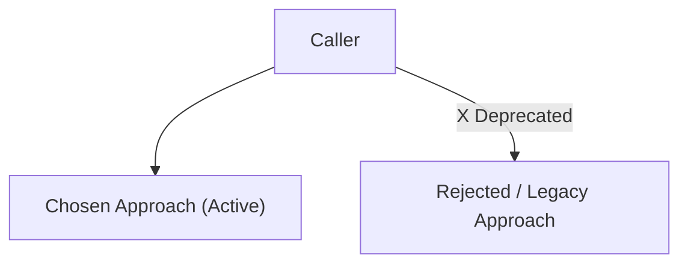

# {NNNN}: {Short Title of Decision}

* **Status**: proposed | accepted | deprecated | superseded by [NNNN]
* **Date**: {YYYY-MM-DD}
* **Deciders**: {Names / handles}

## Context and Problem Statement

{2–5 sentences describing the current situation, technical constraints, anti-patterns, or forces motivating this decision.}

## Decision Drivers

* {Driver 1: e.g., operational simplicity, latency, maintainability}
* {Driver 2: e.g., backward compatibility, type safety, testing speed}

## Considered Options

* **Option 1 (Chosen)**: {Short description}
* **Option 2**: {Short description}
* **Option 3**: {Short description}

## Decision Outcome

Chosen option: **Option 1**, because {short rationale highlighting key drivers}.

### Pros and Cons of the Options

#### Option 1: {Chosen Option Name}
* **Good, because** {benefit 1}
* **Good, because** {benefit 2}
* **Bad, because** {trade-off 1}

#### Option 2: {Alternative Option Name}
* **Good, because** {benefit 1}
* **Bad, because** {drawback 1}
* **Why Rejected**: {specific reason}

## Confirmation & Verification Strategy

How will this decision be verified and enforced across the codebase?

* **Automated Checks / Tests**: {Linter rules, CI checks, or test targets}
* **Module / Visibility Boundaries**: {Package boundaries or deprecation annotations, if applicable}
* **Migration Path**: {Steps to transition existing code, if applicable}

## Architecture Diagram

<!-- Optional: Include a Mermaid diagram when it clarifies component boundaries or active vs. deprecated paths. Remove if not needed. -->

## Consequences

### Positive

* {Benefit 1}
* {Benefit 2}

### Negative

* {Trade-off 1}

### Risks & Mitigations

* **Risk**: {Potential failure mode}
  * **Mitigation**: {How it is prevented or detected}
