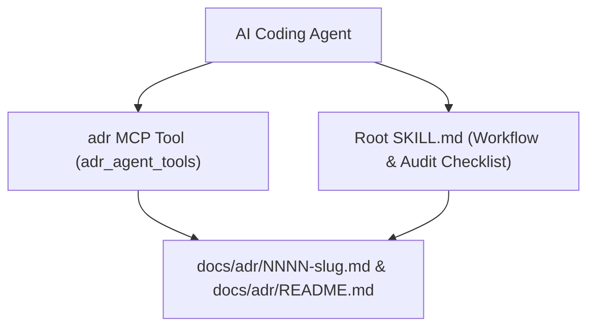

# 0004: Remove Nx Monorepo Scaffolding and Adopt Enhanced MADR 3.0+ Template

* **Status**: accepted
* **Date**: 2026-10-29
* **Deciders**: bestadam

## Context and Problem Statement

The `adr-mcp` repository originally used an Nx and `pnpm` monorepo wrapper (`@aws/nx-plugin`, TypeScript configs, `packages/tools/` nesting, and unused `boto3` / `aws-opentelemetry-distro` dependencies) around a ~90-line Python `FastMCP` server. In addition, the bundled MADR minimal template lacked key sections for long-term architectural governance—such as decision drivers, rejection rationale, verification strategies, and an ADR index table (`docs/adr/README.md`).

## Decision Drivers

* Eliminate unnecessary Node.js, Nx, and unused AWS SDK dependencies for a single-package Python MCP server.
* Retain deterministic MCP tool support (`adr`) for finding the git root, calculating the next 4-digit ADR number (`NNNN`), and initializing `docs/adr/README.md`.
* Incorporate the best lightweight practices from the `architecture-decision-records` skill (MADR 3.0+ template sections, verification strategy, index management, and a root `SKILL.md`).

## Considered Options

* **Option 1 (Chosen)**: Flatten into a single-package `uv` Python project at the repo root, keep the lightweight `FastMCP` server, add a root `SKILL.md`, and upgrade to the enhanced MADR 3.0+ template with `docs/adr/README.md` indexing.
* **Option 2**: Remove Python and the MCP server entirely, converting the repository into a Markdown-only skill.
* **Option 3**: Keep the existing Nx monorepo structure and only update the Markdown template.

## Decision Outcome

Chosen option: **Option 1**, because it removes all Node/Nx and unused dependency bloat while preserving single-call deterministic numbering/scaffolding for MCP clients and providing a portable `SKILL.md` for skill-aware agents.

### Pros and Cons of the Options

#### Option 1: Flat `uv` MCP Package + `SKILL.md` + Enhanced MADR 3.0+ Template
* **Good, because** it removes ~570 KB of Node/Nx lockfiles and unused `boto3` / OpenTelemetry dependencies, leaving only `mcp` and `pydantic`.
* **Good, because** the `adr` MCP tool deterministically resolves `.git`, creates `docs/adr/` and `docs/adr/README.md`, and calculates the next 4-digit prefix in one tool call.
* **Good, because** including `SKILL.md` alongside the MCP server supports both MCP clients and skill-based agent workflows.
* **Bad, because** it still maintains a small Python package (~100 lines) and `uv.lock`.

#### Option 2: Markdown-Only Skill (No MCP Server)
* **Good, because** it has zero runtime dependencies.
* **Bad, because** agents must make multiple filesystem calls to locate `.git`, list `docs/adr/`, compute the next sequence number, and load the template, and MCP-only clients cannot use it as a tool.
* **Why Rejected**: Keeping the lightweight Python MCP server costs very little once Nx and unused dependencies are removed, and provides deterministic numbering and index setup.

#### Option 3: Keep Nx Monorepo Structure
* **Good, because** it requires no structural file moves.
* **Bad, because** it requires Node.js, `pnpm`, and Nx just to lint, test, or run a single small Python package.
* **Why Rejected**: The monorepo tooling overhead far outweighed the simplicity of the project.

## Confirmation & Verification Strategy

How will this decision be verified and enforced across the codebase?

* **Automated Checks / Tests**: Run `uv run pytest` and `uv run ruff check .` to verify git root discovery, sequential `NNNN` numbering, `docs/adr/README.md` initialization, and MADR 3.0+ template loading.
* **Module / Visibility Boundaries**: Single package layout under `adr_agent_tools/` with no Node/Nx configuration files in the repository root.

## Architecture Diagram

## Consequences

### Positive

* Development and execution only require `uv` (`uv run pytest`, `uv run ruff check .`, `uv run adr-mcp-stdio`).
* Generated ADRs now include decision drivers, explicit rejection reasons, verification strategies, and automatic `docs/adr/README.md` index initialization.

### Negative

* Existing Nx commands (`pnpm exec nx ...`) are replaced by standard `uv run` commands.

### Risks & Mitigations

* **Risk**: Calling agents might create an ADR file without updating `docs/adr/README.md`.
  * **Mitigation**: `setup_adr_directory()` automatically initializes `docs/adr/README.md` and returns `index_file` and step-by-step `guidelines` in `AdrData`.
